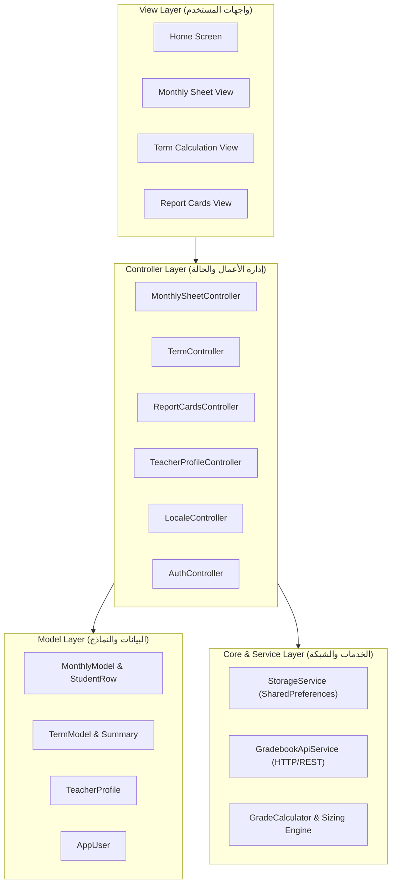

# راصد الدرجات (Grade Tracker) - دليل المعمارية والتوثيق الشامل

تطبيق متطور وعصري لإدارة وتتبع ورصد درجات وسجلات الطلاب للمعلمين والمدارس، مبني بإطار العمل **Flutter** وفق أعلى معايير هندسة البرمجيات ونمط **MVC (Model-View-Controller)** و **Clean Architecture**.

---

## الفهرس
1. [نظرة عامة على التطبيق](#نظرة-عامة-على-التطبيق)
2. [الهيكل المعماري البرمجي (MVC & Clean Architecture)](#الهيكل-المعماري-البرمجي)
3. [إدارة الحالة (State Management with Provider)](#إدارة-الحالة)
4. [التوافق الشامل مع كافة الشاشات (Screen Responsiveness with ScreenUtil)](#التوافق-الشامل-مع-كافة-الشاشات)
5. [نظام الترجمة ومنع الـ Hard Code (Zero-Hardcoding Localization)](#نظام-الترجمة-ومنع-الـ-hard-code)
6. [تنظيم الـ API ونقاط الاتصال (Endpoints Architecture)](#تنظيم-الـ-api-ونقاط-الاتصال)
7. [قواعد احتساب الدرجات والعمليات الرياضية وجبر الكسور](#قواعد-احتساب-الدرجات-والعمليات-الرياضية)
8. [شجرة المجلدات والملفات المنظمة](#شجرة-المجلدات-والملفات-المنظمة)
9. [طريقة التشغيل والبناء (How to Run)](#طريقة-التشغيل-والبناء)

---

## نظرة عامة على التطبيق

يقدم التطبيق حلاً شاملاً للمدرسين لإدارة الدرجات عبر 3 أقسام رئيسية متناسقة بألوانها وهوية التصميم الأكاديمية:
- **الجدول (Monthly Sheet)**: رصد الدرجات الشهرية والامتحانات التحريرية مع دعم أعمدة مخصصة ديناميكية (شفهي، يومي، نشاط، سلوك). لون التبويب: أزرق هادئ `#5692BE`.
- **المعدل (Term Calculation)**: حساب المعدلات الفصلية والنهائية التلقائية للطلاب عبر الأشهر المختارة إما بـ (المتوسط الحسابي، المجموع، أو درجة فردية). لون التبويب: تيراكوتا قرميدي `#B86848`.
- **الكروت والشهادات (Report Cards)**: توليد بطاقات درجات وشهادات تقديرية أنيقة للطلاب قابلة للطباعة والمعاينة تحوي شعار المدرسة الأكاديمي، بيانات المعلم، تفاصيل الدرجات، والتقييم اللفظي. لون التبويب: أخضر غابي `#4E7A68`.

---

## الهيكل المعماري البرمجي

تم تصميم التطبيق وفق مبادئ **Clean Architecture** ونمط **MVC**:



### معايير النظافة البرمجية:
- **لا يتجاوز أي ملف 150-180 سطرًا** (حيث تم تجزئة الواجهات الكبيرة إلى مكونات مستقلة ومختصة).
- فصل كامل بين طبقة العرض وطبقة منطق العمل وطبقة البيانات.
- أسماء دلالية وتوثيق بالتعليقات لكل فئة ودالة ومتغير.

---

## إدارة الحالة

تعتمد إدارة الحالة على حزمة `provider` عبر فئات `ChangeNotifier`:
- `MonthlySheetController`: إدارة نماذج الأشهر، الأعمدة الديناميكية، بيانات الطلاب، وتحديث الدرجات فورياً.
- `TermController`: حساب المعدلات وتوليد ملخصات الفصول.
- `TeacherProfileController`: مزامنة بيانات الأستاذ والمدرسة والعام الدراسي.
- `ReportCardsController`: إعدادات وتنسيق طباعة الشهادات والبطاقات.
- `LocaleController`: تبديل لغة الواجهة الفوري بين العربية والإنجليزية.
- `AuthController`: إدارة حالة تسجيل الدخول، الاشتراك السحابي، والاتصال.

---

## التوافق الشامل مع كافة الشاشات (Mobile + Tablet + Windows Desktop)

تم تطبيق نظام تجاوب ذكي متعدد المنصات يجمع بين مكتبة `flutter_screenutil` ومحرك التكيف المتقدم:
- **التكيف التلقائي للمنصات (Adaptive Baseline)**:
  - **الهواتف الذكية (< 600px)**: يعتمد مقاس تصميم `390 × 844` ليعطي تناسقاً مثالياً على كل أحجام شاشات الموبايل بدون أي Overflow.
  - **الأجهزة اللوحية (600px - 1024px)**: يعتمد مقاس تصميم `768 × 1024`.
  - **شاشات الكمبيوتر والويندوز (>= 1024px)**: يعتمد مقاس تصميم `1440 × 900` مع توسيط الواجهة بحد أقصى `1350px` مما يمنع تضخم العناصر وتمددها المشوه.
- **كبح تضخم الخطوط (Font Size Clamping)**:
  - تم استخدام `fontSizeResolver` لكبح نسبة التكبير بين `0.85` و `1.25` منعاً لتضخم الأسماء والخطوط في شاشات الويندوز العريضة.
- **حماية الجداول ومنع اختفاء الأسماء (Safe DataTables)**:
  - تم تثبيت حد أدنى وأقصى لعرض خانات الأسماء (`minWidth: 130, maxWidth: 240`) مع ضبط ارتفاعات الصفوف لتسمح بالنمو بدون قص (`clipping`).
  - تفعيل شريط التمرير الأفقي والرأسي المزدوج (`Scrollbar`) لتصفح سلس بالفأرة أو اللمس.
- **منع تجاوز الأزرار على الموبايل (Zero-Overflow Toolbars)**:
  - استخدام `Wrap` بدلاً من `Row` الصلبة في شريط إجراءات البطاقات وشريط الأدوات، مع تحويل الشارات إلى أيقونات ذكية على الشاشات الضيقة.
  - شبكة عرض متجاوبة (`GridView`) على الويندوز والتابلت، وقائمة عمودية ذكية على الموبايل.

---

## نظام الترجمة ومنع الـ Hard Code

التطبيق خالٍ تماماً من أي نصوص ثابتة (Zero Hardcoding):
- **مفتاح لكل نص**: معرف في `AppKeys` لتفادي أخطاء الطباعة.
- **قاموس عربي كامل**: معرف في `arTranslations`.
- **قاموس إنجليزي كامل**: معرف في `enTranslations`.
- **وصول فوري مختصر**: عبر إضافة `context.tr(AppKeys.tabMonthly)`.
- **دعم كامل لاتجاه النص**: `RTL` للغة العربية و `LTR` للغة الإنجليزية مع التبديل المباشر أثناء التشغيل.

---

## تنظيم الـ API ونقاط الاتصال والمصادقة الحقيقية

تطبيق راصد الدرجات يتصل مباشرة بالخادم السحابي الحي على **Cloudflare Pages** وقاعدة بيانات **Cloudflare D1 (SQLite)** عبر الدومين المباشر `https://daragat.pages.dev`، ومصادقة **Firebase Authentication REST API** عبر مشروع `gen-lang-client-0369327125`:

| نقطة النهاية (Endpoint) | الطريقة | الوصف والمعاملات |
| :--- | :--- | :--- |
| `identitytoolkit.googleapis.com` | `POST` | تسجيل دخول حقيقي، إنشاء حساب جديد، وإرسال رابط استعادة كلمة المرور |
| `/api/users` | `POST` | تسجيل حساب المعلم في قاعدة بيانات D1 وتفعيل الاشتراك الافتراضي |
| `/api/users?uid=...&email=...` | `GET` | التحقق من حالة الاشتراك (فعال، ملغي، معلق) وتاريخ الانتهاء |
| `/api/data?uid=...` | `GET` | جلب كامل سجلات الطلاب ونماذج الأشهر والفصول المحفوظة سحابياً |
| `/api/data` | `POST` | مزامنة فورية آمنة للسجلات وقوائم الطلاب وملف المعلم مع السحابة |
| `/api/extract-students` | `POST` | استخراج أسماء ودرجات الطلاب من الصور بواسطة نموذج Gemini Vision الذكي |

- **المصادقة والتسجيل الحقيقي**:
  - شاشة `AuthScreen` تقدم تسجيل دخول وإنشاء حساب حقيقي بالبريد وكلمة المرور عبر Firebase، بالإضافة إلى وضع التجربة السريعة المجانية (5 دقائق).
  - يتم إرسال توكن المصادقة المشفر `Authorization: Bearer <token>` إلى خادم Cloudflare للتحقق من هوية المعلم ومطابقة صلاحياته.
- **التخزين الهجين (Offline-First)**:
  - عند انقطاع الإنترنت أو العمل بدون شبكة، يعمل التطبيق بكامل وظائفه محلياً ويقوم بالمزامنة التلقائية فور عودة الاتصال.

---

## قواعد احتساب الدرجات والعمليات الرياضية

تم تضمين كافة القواعد الدقيقة لوزارة التربية واحتياجات المعلمين في `GradeCalculator`:
1. **الامتحان التحريري**:
   - وضع الدرجة الخام كما في الورقة (`raw`).
   - أو التحويل النسبي المئوي (`relative`): `(الدرجة / الدرجة العظمى) × وزن التحريري`.
2. **الأعمدة المخصصة**:
   - مجموع الدرجات للأعمدة المضافة (شفهي، يومي، نشاط، سلوك).
3. **العمليات الرياضية على الدرجة النهائية**:
   - قسمة (`÷`)، ضرب (`×`)، جمع (`+`)، أو طرح (`-`).
4. **جبر الكسور والتقريب**:
   - بدون جبر (`none`): الحفاظ على الكسور العشرية بدقة.
   - جبر من النصف فأكثر (`half_up`): الكسر `>= 0.5` يجبر للعدد الصحيح الأعلى.
   - جبر أي كسر عشري (`any_fraction`): أي كسر `>= 0.1` يجبر للعدد الأعلى مباشرة.
   - عتبة مخصصة (`custom_threshold`): تحديد كسر مخصص (مثلاً 0.3 أو 0.7).
5. **التقديرات اللفظية والشارات اللونية**:
   - **ممتاز**: `>= 90%` (لون أخضر زمردي `#059669`)
   - **جيد جداً**: `>= 80%` (لون أزرق ملكي `#2563EB`)
   - **جيد**: `>= 70%` (لون فيروزي `#0D9488`)
   - **متوسط**: `>= 60%` (لون عنبري `#D97706`)
   - **مقبول**: `>= 50%` (لون برتقالي `#EA580C`)
   - **راسب**: `< 50%` (لون وردي أحمر `#E11D48`)

---

## شجرة المجلدات والملفات المنظمة

```
lib/
├── main.dart                                   # نقطة انطلاق التطبيق وتثبيت الـ Providers
├── core/
│   ├── constants/
│   │   ├── api_endpoints.dart                  # نقاط اتصال الـ REST API والترويسات
│   │   └── app_constants.dart                  # الثوابت العامة وإعدادات الشاشة
│   ├── localization/
│   │   ├── app_localizations.dart              # محرك الترجمة ومساعد context.tr()
│   │   ├── ar_translations.dart                # القاموس العربي الكامل
│   │   ├── en_translations.dart                # القاموس الإنجليزي الكامل
│   │   └── translation_keys.dart               # مفاتيح الترجمة الموحدة
│   ├── theme/
│   │   ├── app_colors.dart                     # لوحة الألوان المعتمدة للتطبيق
│   │   ├── app_text_styles.dart                # الخطوط المتجاوبة بنظام ScreenUtil
│   │   └── app_theme.dart                      # إعدادات ThemeData العامة
│   └── utils/
│       ├── grade_calculator.dart               # خوارزميات الحساب والتقريب والتقديرات
│       └── responsive_utils.dart               # إضافات التباعد والتجاوب
├── models/
│   ├── app_user.dart                           # نموذج بيانات المستخدم والاشتراك
│   ├── custom_column.dart                      # نموذج الأعمدة المخصصة
│   ├── final_score_operation.dart              # نموذج العمليات الحسابية
│   ├── monthly_model.dart                      # نموذج الشهر والامتحان
│   ├── print_settings.dart                     # نموذج إعدادات الطباعة
│   ├── student_row.dart                        # نموذج بيانات الطالب والدرجات
│   ├── student_term_summary.dart               # نموذج ملخص الفصل والمعدل
│   └── teacher_profile.dart                    # نموذج بيانات المعلم والمدرسة
├── controllers/
│   ├── auth_controller.dart                    # إدارة الجلسة والاتصال
│   ├── locale_controller.dart                  # إدارة اللغة والتبديل الحي
│   ├── monthly_sheet_controller.dart           # إدارة جدول الدرجات والطلاب
│   ├── report_cards_controller.dart            # إدارة الشهادات والكروت
│   ├── teacher_profile_controller.dart         # إدارة بيانات المعلم والمدرسة
│   └── term_controller.dart                    # إدارة الفصول وحساب المعدلات
├── services/
│   ├── gradebook_api_service.dart              # خدمة التواصل مع السيرفر السحابي
│   └── storage_service.dart                    # خدمة الحفظ المحلي (SharedPreferences)
├── views/
│   ├── auth/
│   │   ├── auth_screen.dart                    # شاشة تسجيل الدخول وإنشاء الحساب والتجربة المجانية
│   │   └── widgets/
│   │       ├── auth_toggle_bar.dart            # شريط التبديل بين الدخول والتسجيل
│   │       ├── forgot_password_dialog.dart     # نافذة استعادة كلمة المرور عبر Firebase
│   │       ├── google_sign_in_banner.dart      # شريط الدخول المباشر بحساب Google
│   │       └── google_sign_in_dialog.dart      # نافذة مصادقة حساب Google
│   ├── common/
│   │   ├── academic_emblem.dart                # شعار المدرسة الأكاديمي المخصص
│   │   ├── confirm_dialog.dart                 # نافذة تأكيد الإجراءات
│   │   ├── custom_button.dart                  # زر متجاوب بتصميم الهوية
│   │   ├── custom_text_field.dart              # حقل إدخال متجاوب
│   │   ├── rating_badge.dart                   # شارة التقدير اللفظي الملونة
│   │   └── sync_badge.dart                     # شارة المزامنة السحابية والمحلية
│   ├── home/
│   │   ├── home_screen.dart                    # الشاشة الرئيسية الجامعة
│   │   └── widgets/
│   │       ├── home_drawer_menu.dart           # قائمة الأدوات والمزيد (Bottom Sheet)
│   │       ├── drawer_user_header.dart         # بطاقة معلومات الحساب المسجل وشارة Google
│   │       ├── contact_support_dialog.dart     # نافذة الاتصال والدعم (هاتف / واتس / إيميل)
│   │       ├── subscription_details_dialog.dart # نافذة تفاصيل ونوع وصلاحية الاشتراك
│   │       ├── privacy_policy_dialog.dart      # نافذة سياسة الخصوصية وسرية البيانات
│   │       ├── delete_account_dialog.dart      # نافذة تأكيد الحذف النهائي للحساب
│   │       ├── import_backup_dialog.dart       # نافذة استرجاع واستيراد النسخة الاحتياطية
│   │       ├── home_header.dart                # الترويسة العلوية بمعلومات المعلم
│   │       └── home_tab_bar.dart               # شريط التبويبات الثلاثة
    ├── monthly_sheet/
    │   ├── monthly_sheet_view.dart             # الواجهة الكاملة لجدول الشهر
    │   └── widgets/
    │       ├── add_column_dialog.dart          # نافذة إضافة عمود مخصص
    │       ├── add_model_dialog.dart           # نافذة إضافة شهر جديد
    │       ├── add_student_dialog.dart         # نافذة إضافة طالب
    │       ├── final_operation_dialog.dart     # نافذة العمليات الحسابية
    │       ├── model_selector_bar.dart         # شريط اختيار وتصفح الأشهر
    │       ├── rounding_settings_dialog.dart   # نافذة إعدادات التقريب والجبر
    │       ├── sheet_toolbar.dart              # شريط البحث والإجراءات السريعة
    │       ├── student_data_table.dart         # جدول درجات الطلاب المتجاوب
    │       └── student_row_item.dart           # صف الطالب في الجدول وتعديل الدرجات
    ├── term_calculation/
    │   ├── term_calculation_view.dart          # الواجهة الكاملة لحساب المعدل
    │   └── widgets/
    │       ├── create_term_dialog.dart         # نافذة إنشاء فصل واختيار الأشهر
    │       ├── term_selector_bar.dart          # شريط اختيار وتصفح الفصول
    │       └── term_summary_table.dart         # جدول معدلات الفصول للطلاب
    ├── report_cards/
    │   ├── report_cards_view.dart              # الواجهة الكاملة لبطاقات الطلاب
    │   └── widgets/
    │       ├── print_settings_dialog.dart      # نافذة إعدادات الطباعة
    │       ├── report_card_item.dart           # بطاقة الطالب والشهادة الأكاديمية
    │       └── single_student_card_dialog.dart # نافذة معاينة وطباعة بطاقة واحدة
    └── teacher_profile/
        └── teacher_profile_dialog.dart         # نافذة تعديل بيانات المعلم والمدرسة
```

---

## طريقة التشغيل والبناء

### 1. تثبيت الحزم:
```bash
flutter pub get
```

### 2. فحص الأكواد والتأكد من خلوها من الأخطاء:
```bash
flutter analyze
```

### 3. تشغيل الاختبارات:
```bash
flutter test
```

### 4. تشغيل التطبيق:
```bash
# على محاكي أو جهاز حقيقي:
flutter run

# أو على متصفح الويب:
flutter run -d chrome

# أو على نظام ويندوز:
flutter run -d windows
```
